# The new look: what changed and how to see it

Date: 2026-11-17. Written by task chat 8.24 (redesign merge) for Rosario. All screenshots use made-up data, not your numbers.

## In short

The app keeps every feature it had. It now looks like redesign A, the one you picked: a near-black screen with a bright **volt** (yellow-green) accent, big bold numbers and real photos of every move. Good parts of the other three designs are added in. Light mode is still there: white cards, a black main button with volt words.

## What changed, screen by screen

| Screen | What is new |
|---|---|
| Today | The day's blocks with minutes. The walk minutes now match the walk screen. A list of today's exercises with photos and the suggested weight. |
| Walk, warm-up | Same timers, new look. Warm-up moves show a small moving photo. |
| Set screen | The moving photo sits next to the exercise name, so the weight and reps buttons fit without scrolling. Chips under it: Tips, Video, Where?, Swap. A "Last time" button copies last time's weight and reps with one tap. Done shows "Saved". A fast double tap on Done saves only once. |
| Rest | A big glowing ring. "Saved · 12 kg × 8" for the set you just did. "How many more could you do?" is asked here, on the same screen, and you can skip it. The next exercise shows its photo and where its machine is in your gym. "Undo that set" is far from Skip. |
| Swap | Each choice has a photo and the reason has an icon and words. |
| Gym (new tab) | Every machine the plan uses, grouped by area of the gym, with a counter like "3 of 15 noted" (machines your gym does not have are hidden). Each machine card: photo, the usual name on its sign (the gym's sign may differ), one set-up tip, and your own "Where it is in my gym" note with quick words like "Upstairs" or "By the mirrors". |
| Plan | A switch: Week, Exercises, Machines, with photos. Print still gives clean tables. |
| Progress | Totals at the top, the weight chart, best sets marked in gold, and for each exercise its chart and last 3 workouts. |
| Weekly, weigh-in, targets | Number tiles in the new style. |
| Settings | A new "Look" card: Auto, Light or Dark, and an Animations switch. Both stay on this phone only. |

## Screenshots

Dark mode on the left of each pair where there is one. Files are in [screens/](screens/).

| | |
|---|---|
| 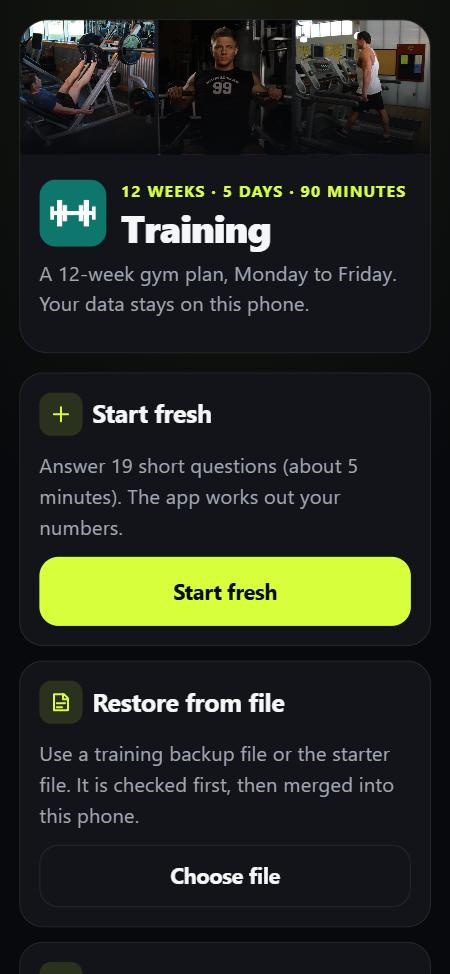 | 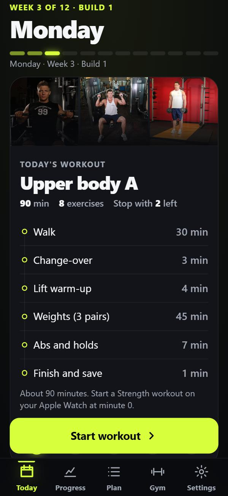 |
| 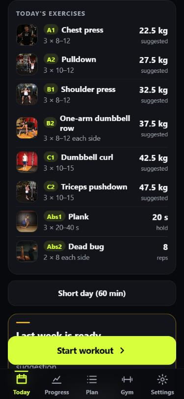 | 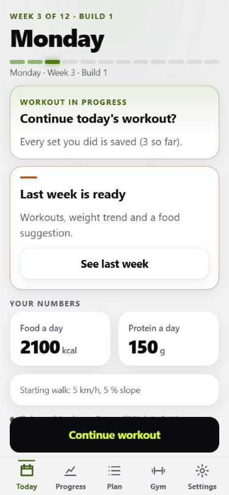 |
| 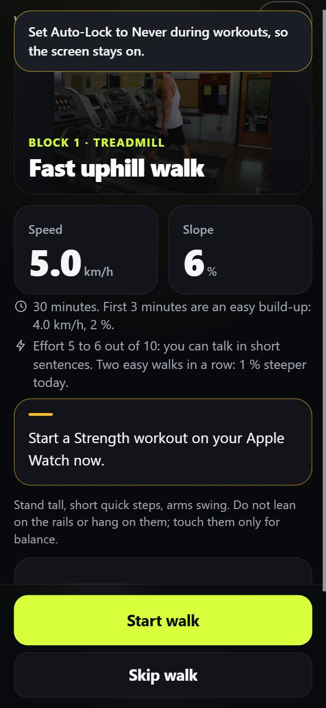 | 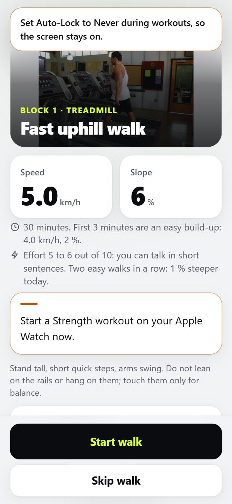 |
| 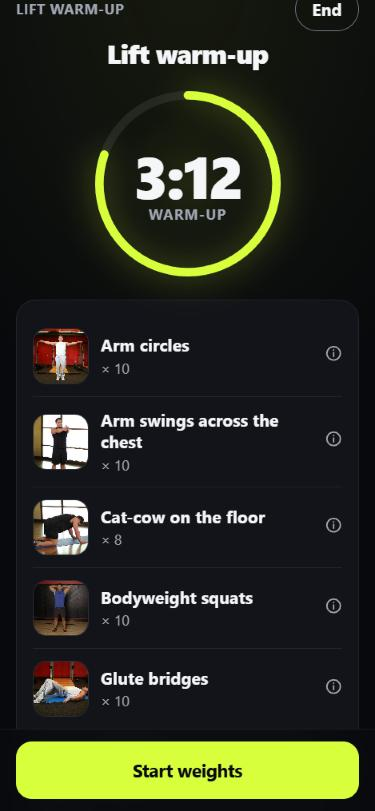 | 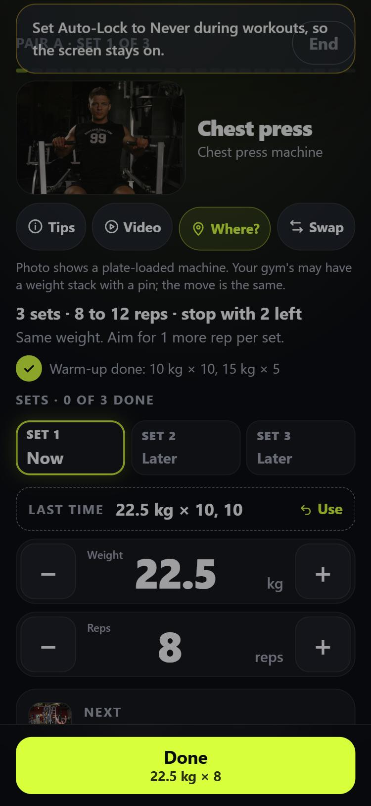 |
| 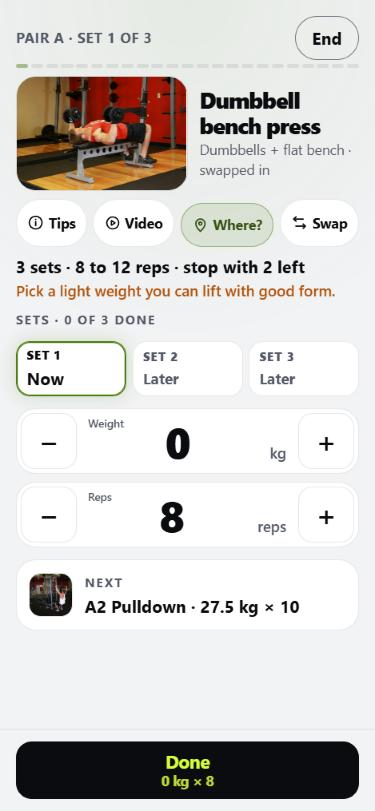 | 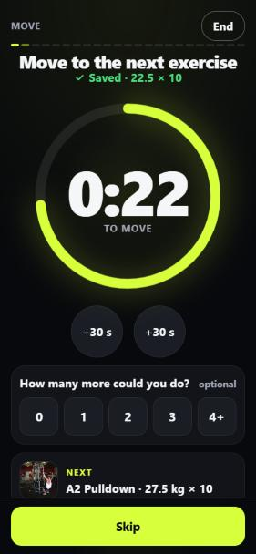 |
| 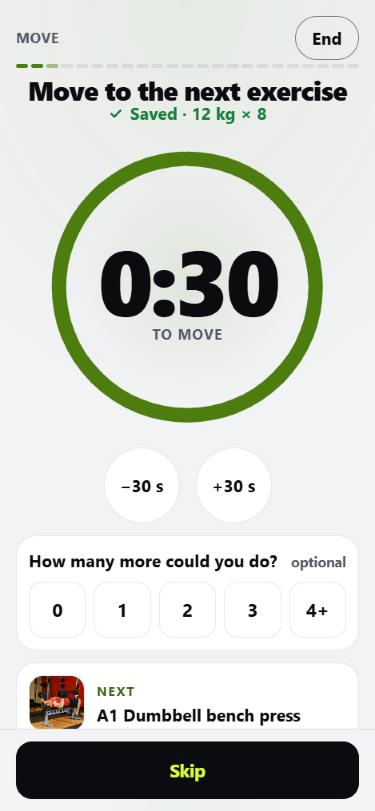 | 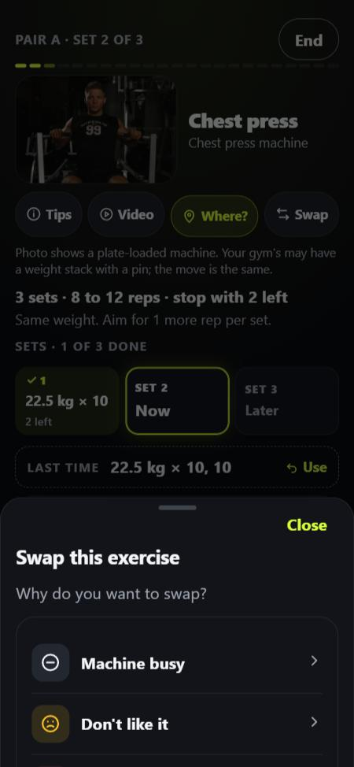 |
| 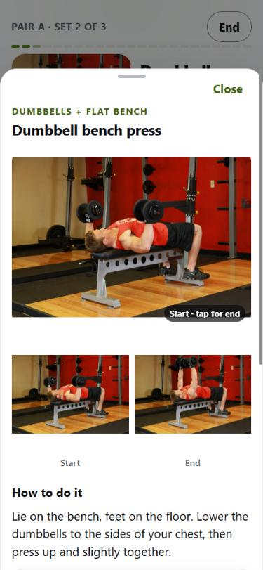 | 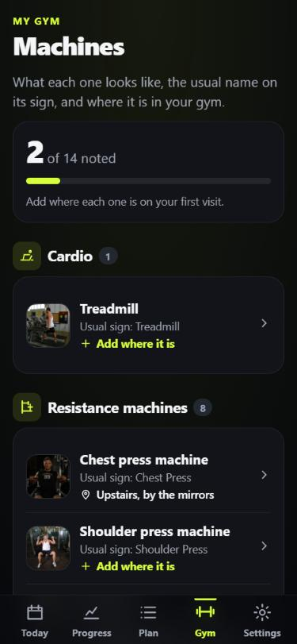 |
| 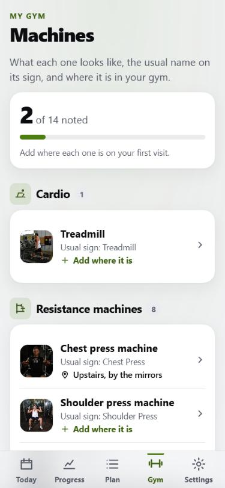 | 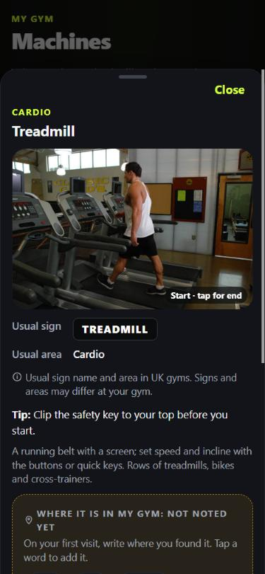 |
| 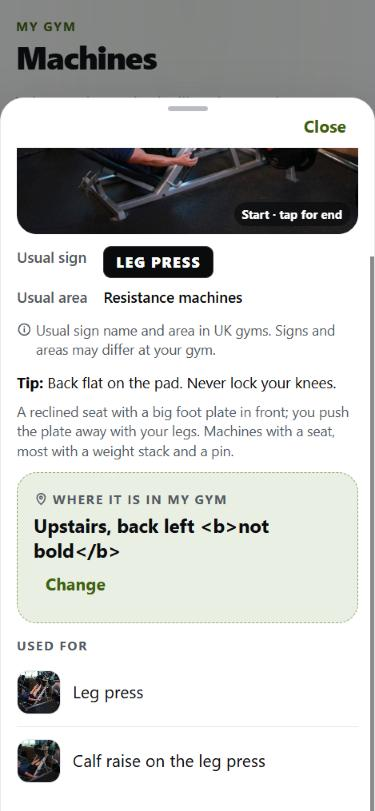 | 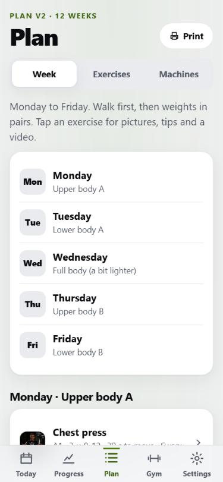 |
| 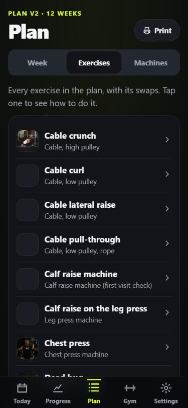 | 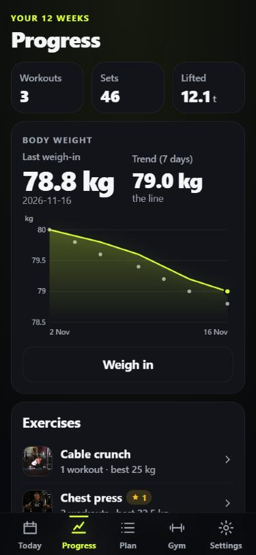 |
| 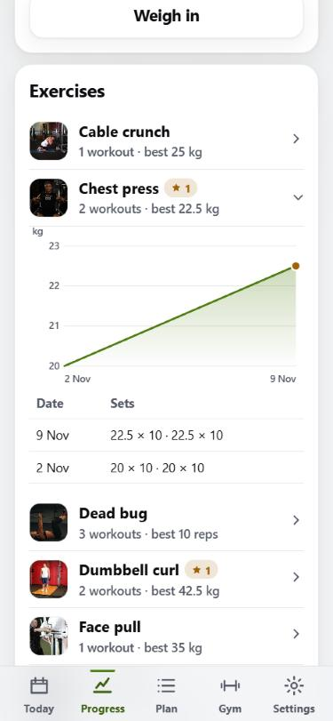 | 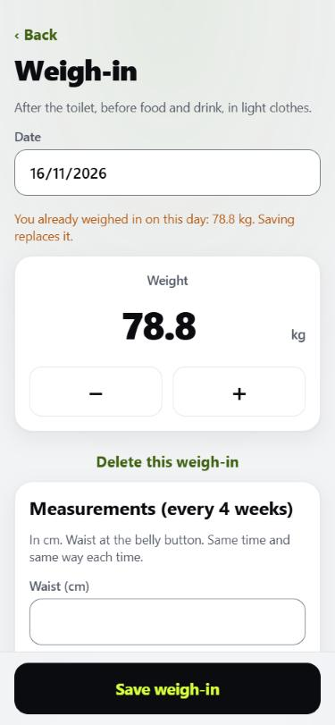 |
| 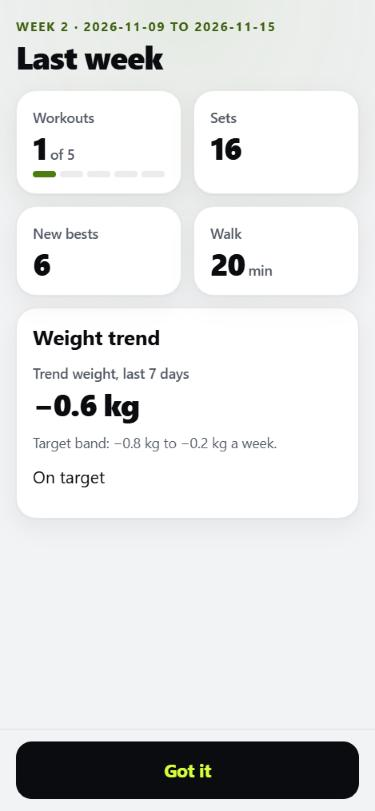 | 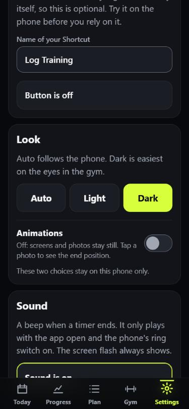 |
| 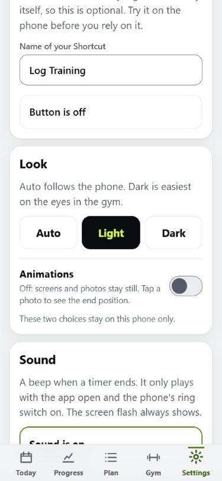 | 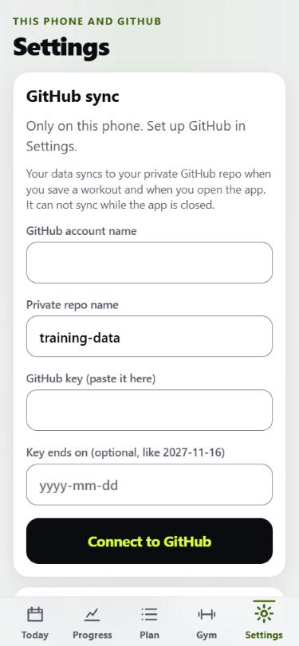 |

## How to look at it on your iPhone (before it goes online)

The new version is only on your computer for now. You can open it on the iPhone over your home Wi-Fi.

1. The computer and the iPhone must be on the **same Wi-Fi**.
2. On the computer, find its local address: open PowerShell, type `ipconfig`, and look for **IPv4 Address** under your Wi-Fi adapter. It looks like `192.168.1.23`.
3. In PowerShell, in the training folder, start a small web server:

   ```
   python -m http.server 8000 --bind 0.0.0.0 --directory app
   ```

   If Windows asks whether to allow Python on networks, allow **private networks only**.
4. On the iPhone, open Safari and type `http://<the IPv4 address>:8000/` (for example `http://192.168.1.23:8000/`).
5. Look around. Start fresh with made-up answers; nothing you type there reaches your real app or your GitHub file.
6. When you are done, go back to PowerShell and press **Ctrl + C** to stop the server. Do not leave it running, and do not open any other port.

**What does not work in this way of looking (this is normal):** offline mode and "Add to Home Screen" need a secure (https) address, so they only work after the push to GitHub Pages. The app data you make here stays in Safari for that address only; it is separate from your installed app.

## What comes next

1. A safety review by Opus of the changed parts (sync data, the machine notes, untrusted text on the page).
2. Your look on the iPhone (the steps above).
3. Only after that, and only after you type the yes in the pushing chat: the push to GitHub, and the new version reaches your installed app with the "New version ready" banner.
